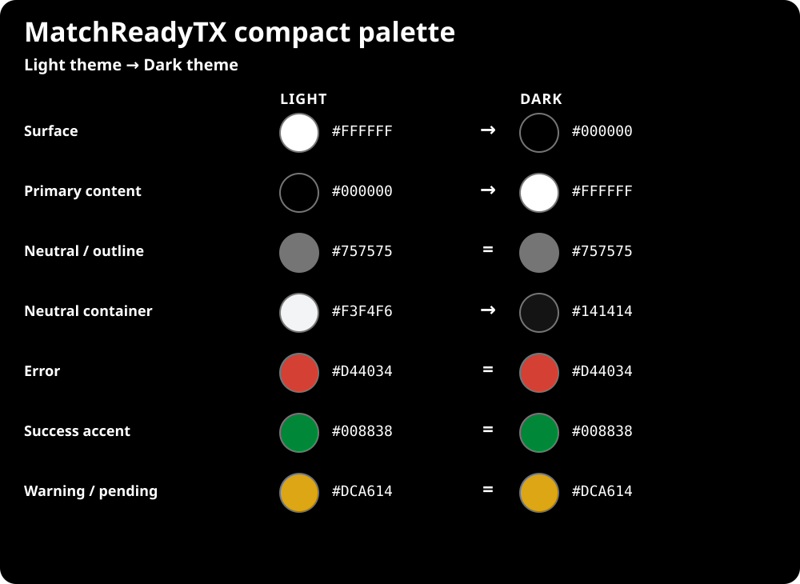

# MatchReadyTX Color Counterparts

## Simplification rule

The app uses a compact core palette plus a few semantic container tones. The
goal is consistent meaning and accessible contrast, not an arbitrary color
count. Each row is one light → dark counterpart; colors marked `=` stay
identical in both themes.

The foundation is absolute across app-owned UI:

`#FFFFFF` light surface → `#000000` dark surface
`#000000` light content → `#FFFFFF` dark content

Google and Apple controls reuse this palette. The multicolor Google logo is
brand artwork, not part of the theme token set.

Source of truth: [`src/styles/tokens.css`](../src/styles/tokens.css) and
[`src/theme/m3Theme.ts`](../src/theme/m3Theme.ts).
